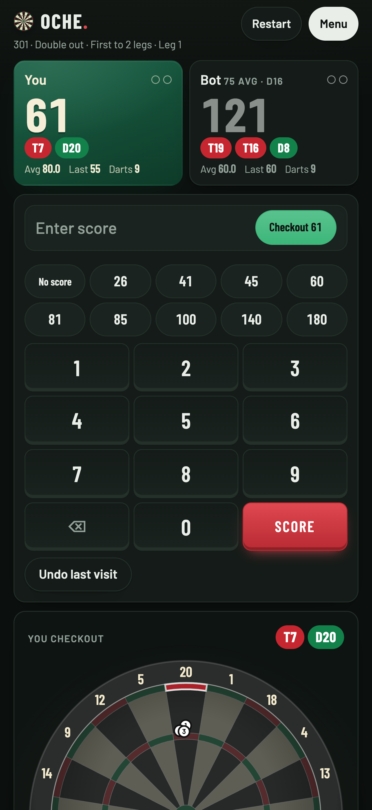
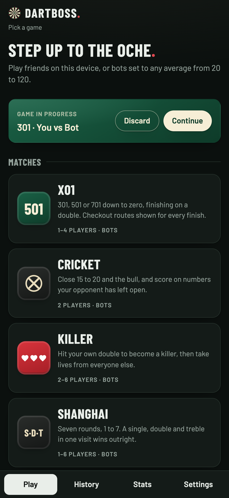
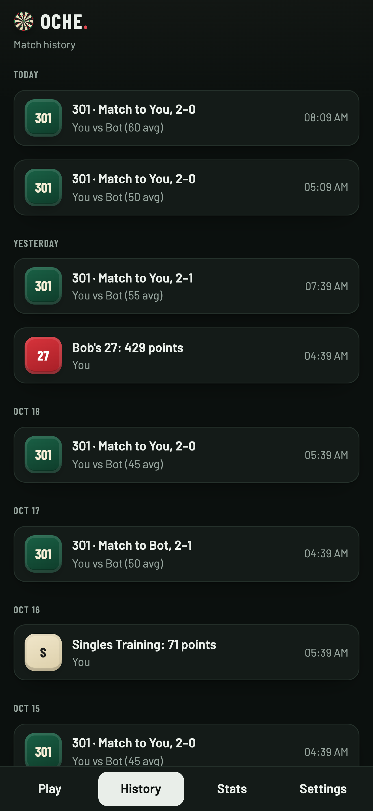
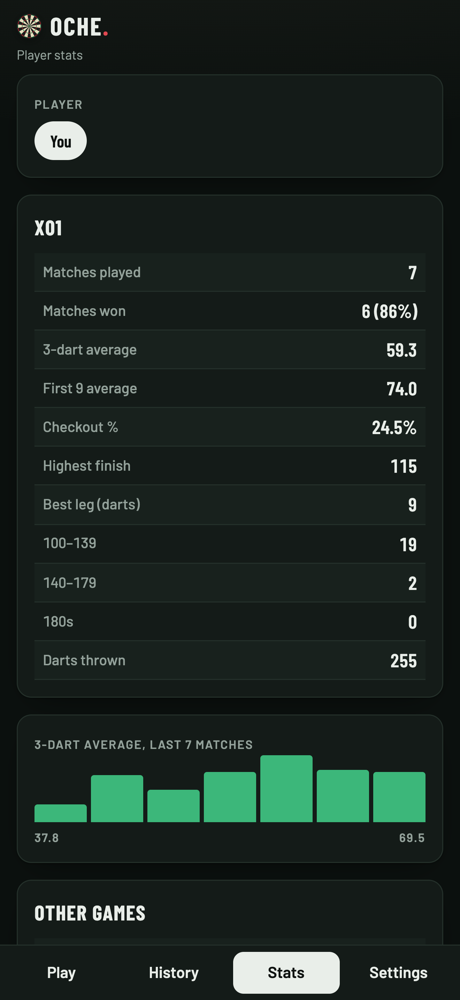

# Dartboss

A darts scorer and trainer for your phone, tablet or browser. Score X01, Cricket, Killer and more against friends, or against bots that throw like real players, and keep your stats over time. It works offline, and everything stays on your device.

<p align="center">
  
  
  
  
</p>

## Highlights

- **X01 the way it's played:** 301, 501, 701 or a custom start, any in and out rule, legs or sets, and a checkout route for every finishable score.
- **Ten more games:** Cricket, Killer, Shanghai and Halve It to play, plus practice with 121 Checkout, Around the Clock, Bob's 27, and Doubles, Singles and Score Training.
- **Bots that feel human:** set any average from 20 to 120. They miss up and down more than sideways, find the doubles harder at lower levels and feel the pressure on a match dart.
- **History and stats:** every match is kept with its score sheet. Lifetime averages, checkout %, 180s and a trend for each player.
- **Across phones:** in any game with two or more players, everyone can use their own phone. Join with a code, a QR code or a link; the host can score for anyone without one.
- **A caller:** scores, finishes and "game shot" called out loud in X01, with the shout saved for the big ones.
- **Made for the oche:** quick scores, a one-tap checkout, undo, and a screen that stays awake between visits.
- **Private:** no accounts, no ads and no tracking. It works fully offline; only a shared game on several phones uses the network, directly between the phones.

## Run it

```bash
npm install
npm run serve      # builds and serves the web app at http://127.0.0.1:8765
```

For the iOS app, run `npm run ios:sync` and then `npm run ios:open` to build it in Xcode.

For the Android app, run `npm run android:sync` and then `npm run android:open` to build it in Android Studio, or `npm run android:build` for a debug APK from the command line (needs JDK 21 and the Android SDK, see [Development](docs/development.md#android)).

## Documentation

| | |
|---|---|
| [Games and options](docs/games.md) | every game and its settings |
| [How the bots play](docs/bots.md) | the throwing model, strategy and calibration |
| [The caller](docs/caller.md) | how the X01 calls are made and regenerated |
| [Development](docs/development.md) | project layout, commands, how the code fits together, data |
| [Releasing](docs/releasing.md) | web hosting, CI/CD, and getting the apps onto the App Store and Google Play |

The App Store listing text is in [`store/app-store.md`](store/app-store.md).
