# Design options

Four opt-in redesigns of Oche, layered on top of the current look. The current design stays the default and is unchanged; the options only change colours, type, buttons, keypad, score displays and cards. No markup or game logic differs.

## Try one

Add `?design=<name>` to the page address, for example `http://127.0.0.1:8765/?design=neon` after `npm run serve`. Without the parameter you get the current design. Nothing is stored: reload without the parameter to go back. Each option also follows the Settings theme (system, light, dark) except where noted.

The CSS lives in `src/designs.css`, scoped under `html[data-design="<name>"]`; `scripts/build.mjs` joins it after `style.css`, and a one-line script in `src/head.html` reads the query parameter. To pick a winner, keep that block, make it the default, and delete the other three.

## Current design (for comparison)

| Home | Match |
|---|---|
| 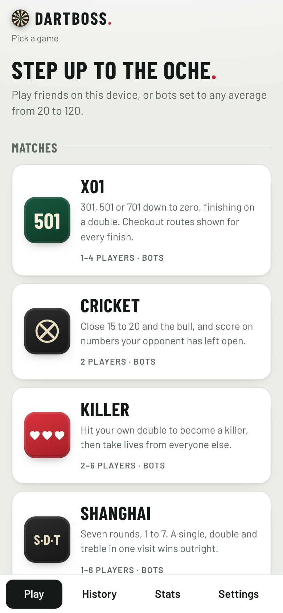 | 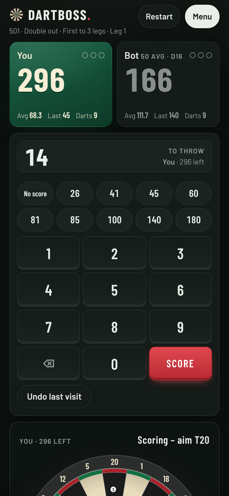 |

## 1. Pub — `?design=pub`

Warm and classic, like the board's own colours. Cream parchment panels with brass double-rule frames, a dark-wood header and tab bar, serif italic headings, round brass-ringed game badges, wooden keypad keys, a red leather Score button, and a chalk-green number readout. The active player is felt green in light mode and burgundy in dark mode (where the wall is green). Light: cream wallpaper. Dark: deep green wall.

| Home (light) | Match (light) | Match (dark) |
|---|---|---|
| 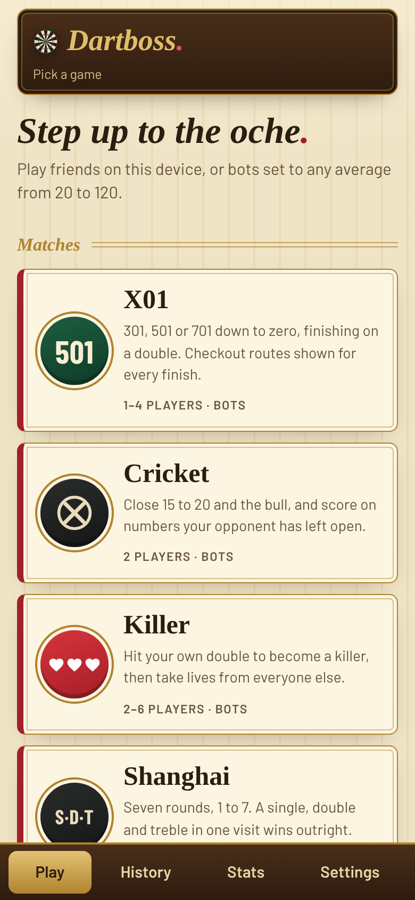 | 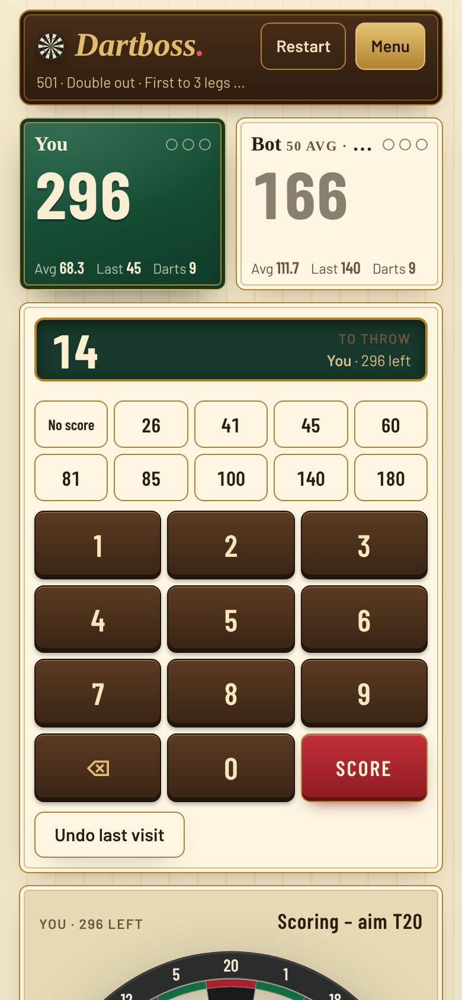 | 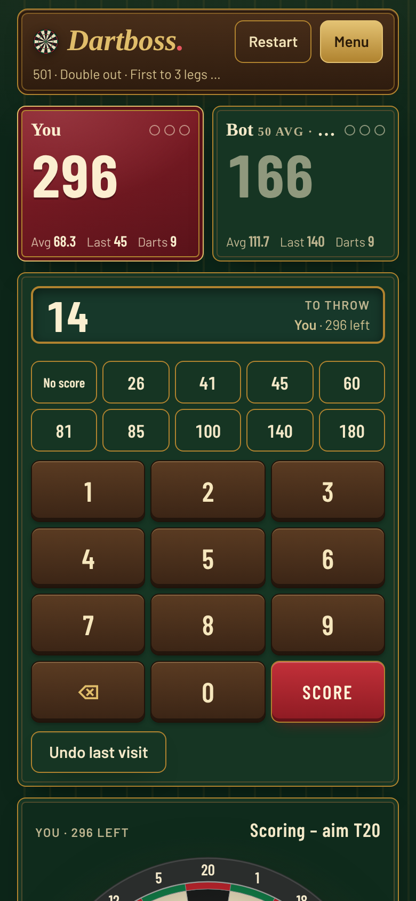 |

## 2. Neon — `?design=neon`

Dark arcade. A faint grid and violet glow behind everything, italic uppercase headings, cyan and magenta accents, outlined glowing buttons, and oversized italic numerals: the thrower's remaining score glows white with a cyan halo and the entry readout is a cyan segment display. Always dark, whatever the system theme.

| Home | Match | Match (light system) |
|---|---|---|
| 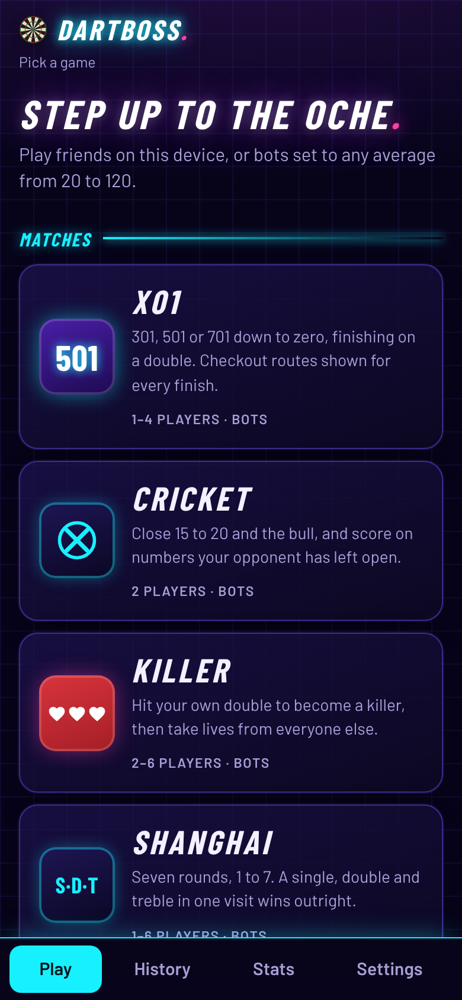 | 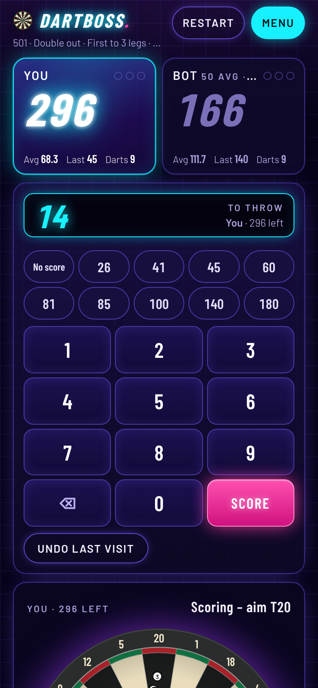 |  |

## 3. Minimal — `?design=minimal`

Clean and airy. Hairline outlines and soft grey fills instead of shadows, generous spacing, light-weight condensed type in sentence case, one red accent. Games are an editorial list rather than cards, the active player is simply outlined with a red dot, and Score is a single solid black button. Light by default; dark is a true near-black with the same restraint.

| Home (light) | Match (light) | Match (dark) |
|---|---|---|
| 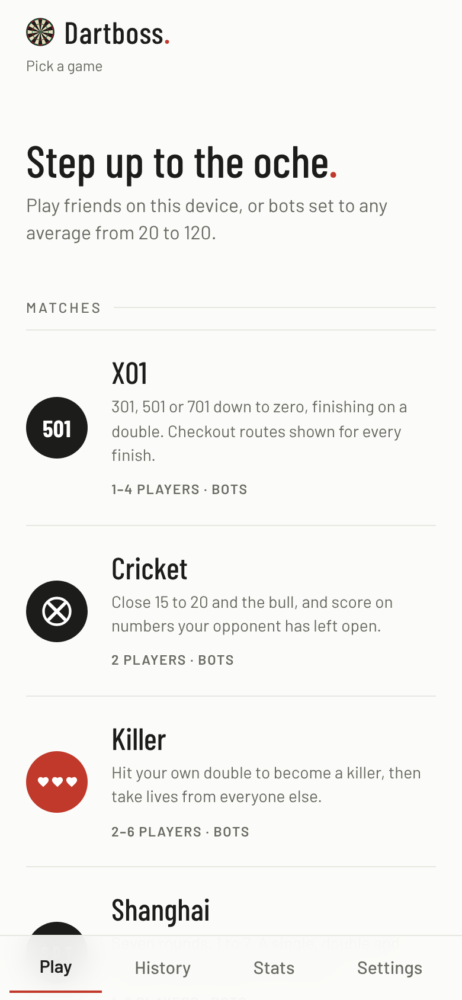 | 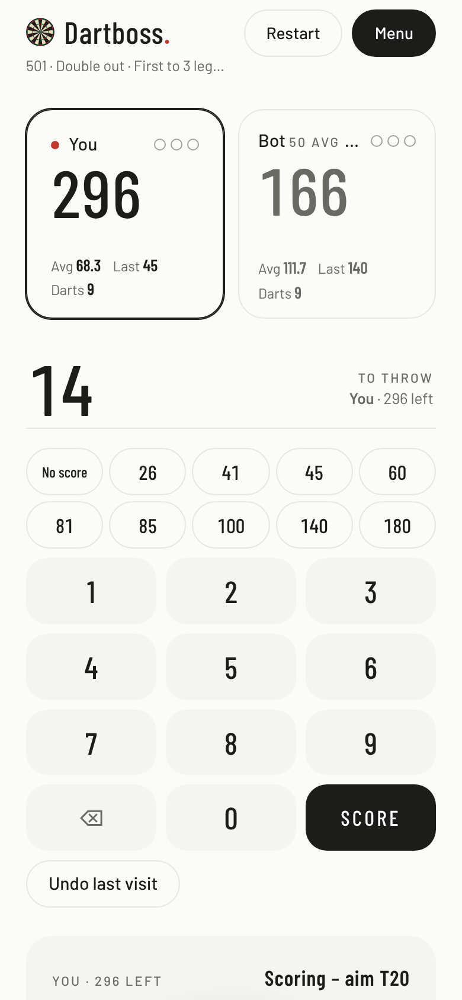 | 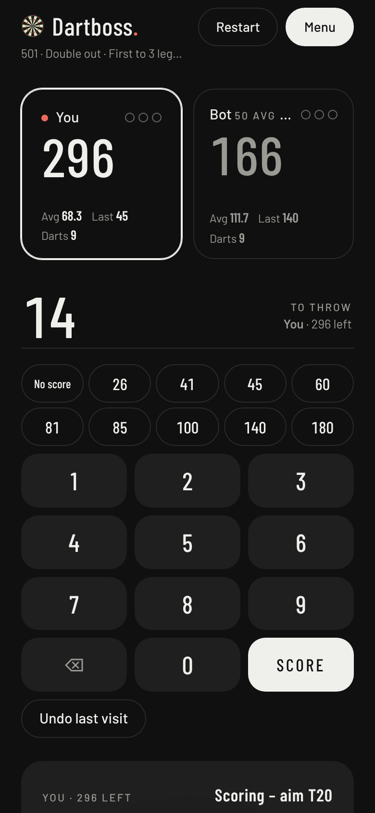 |

## 4. Broadcast — `?design=broadcast`

TV darts scoreboard. Navy gradients, gold highlights, chamfered corners, italic uppercase condensed type. Each player is a score bug with a name strip, and the thrower's strip turns gold. Glossy blue keypad, gold Score button, gold section tags and a gold-topped tab bar. Always dark, whatever the system theme.

| Home | Match | Match (light system) |
|---|---|---|
| 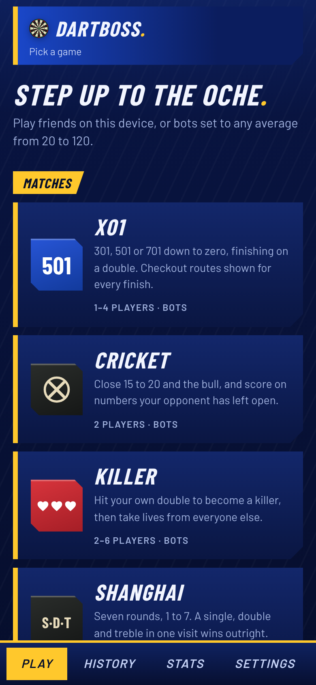 | 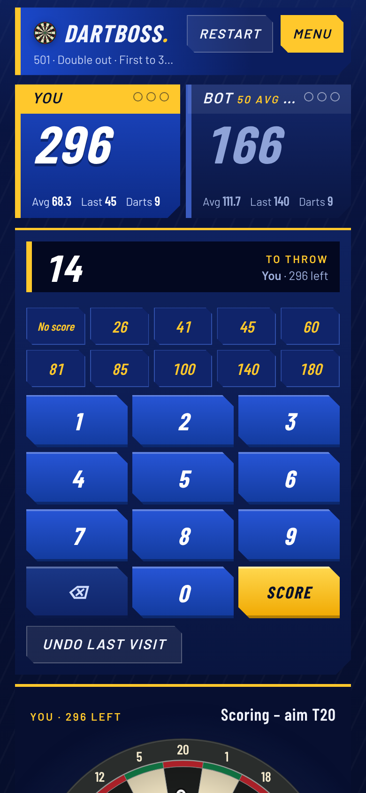 |  |

## Regenerating the screenshots

```bash
npm run build
node scripts/design-previews.mjs          # all designs; or name some: node scripts/design-previews.mjs neon pub
```

Uses `$CHROME`, falling back to `/opt/pw-browsers/chromium`. Files are `<design>-<home|match>-<light|dark>.png`, where light/dark is the emulated system theme (all twenty are in this folder).
